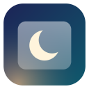

# Dark Glass for Gmail

A Chrome extension that switches Gmail to a dark "glass" look whenever macOS (or any OS) is in dark mode. If you use a Gmail theme with a background image, the image stays and is dimmed behind frosted dark panels.

Everything runs locally in your browser. Nothing is collected or sent anywhere: see the [privacy policy](PRIVACY.md).

Not affiliated with Google. Gmail is a trademark of Google LLC.

## Install (unpacked, for development)

1. Open `chrome://extensions` and turn on **Developer mode**.
2. Click **Load unpacked** and pick this folder.
3. Reload any open Gmail tabs.

The toolbar popup has quick controls (mode, glass, wallpaper brightness, email style). **Wallpaper, accent color and more…** opens the full settings page:

- **Wallpaper:** your Gmail theme, built-in Aurora / Dusk / Ocean / Graphite, or your own image.
- **Glass:** minimum tint, blur, tint from the wallpaper's color.
- **Accent color:** the macOS set (blue, purple, pink, red, orange, yellow, green, graphite), used for links, focus rings, unread and selected rows.
- **Designed emails:** Dark (recolored), Light card (original, with brightness and warmth), or Invert.
- **Remembered senders:** emails you've set to always show original or dark.

Hover any email for **View original / View in dark** and **Always for this sender**.

## How it works

- **`src/content.js`**: reads Gmail's own stylesheets at runtime and writes a dark copy of every color rule and Material 3 token (`--gm3-sys-color-*`). Because it works from Gmail's CSS rather than class names, it keeps working when Gmail renames its compiled classes. It also finds the main panel, wallpaper and message bodies by ARIA role, `data-message-id` and DOM shape, and tags them with `data-gg-*` attributes.
- **`src/glass.css`**: the glass layer. It only targets ARIA roles, `[gh="cm"]` (the compose button), `#loading` and the `data-gg-*` tags.
- **`src/defaults.js`**: settings defaults, accent colors and built-in wallpapers, shared by every part.
- **`src/background.js`**: measures image brightness and color (theme wallpaper, email logos).
- A **health check** runs 12 seconds after Gmail loads. If Gmail has changed so much that its styles can't be converted, dark mode pauses for that load instead of showing light text on white, and the popup says so.
- **`src/color.js`**: color parsing and the light-to-dark mapping rules.
- **Emails**: plain emails get light text. Designed newsletters are recolored: white and light surfaces turn into dark glass and dark text turns light, while brand-colored blocks, buttons and images stay as designed. Dark transparent logos are flipped to light. "Light card" and "Invert" are available in the popup.

The one Gmail class name used is `.a3s` for the message body, and it has a structural fallback.

## Accessibility

- Text is held to WCAG AA (4.5:1). Converted gray text never drops below 75% lightness, and the glass gets thicker automatically over bright wallpapers. `src/background.js` measures the theme image for this. If the image can't be read, the extension assumes a white wallpaper and uses the thickest setting.
- The nav and header get a shaded backing sized to how bright the wallpaper is behind them.
- macOS **Increase contrast**: thicker glass, brighter text, visible borders (aiming for about 7:1).
- macOS **Reduce transparency**: solid panels, no blur.
- Windows high contrast (forced colors) and Gmail's print / "show original" pages: the extension turns itself off.
- A visible blue focus ring for keyboard navigation.

## Permissions

- `storage`: your popup settings.
- Host access to `mail.google.com`, `*.googleusercontent.com`, `*.gstatic.com` and `*.google.com/rd-mail-pt/*`: only so the background worker can read images. It measures the theme image's brightness (Gmail redirects it to `lh3.google.com`) and checks whether email logos are dark-on-transparent.
